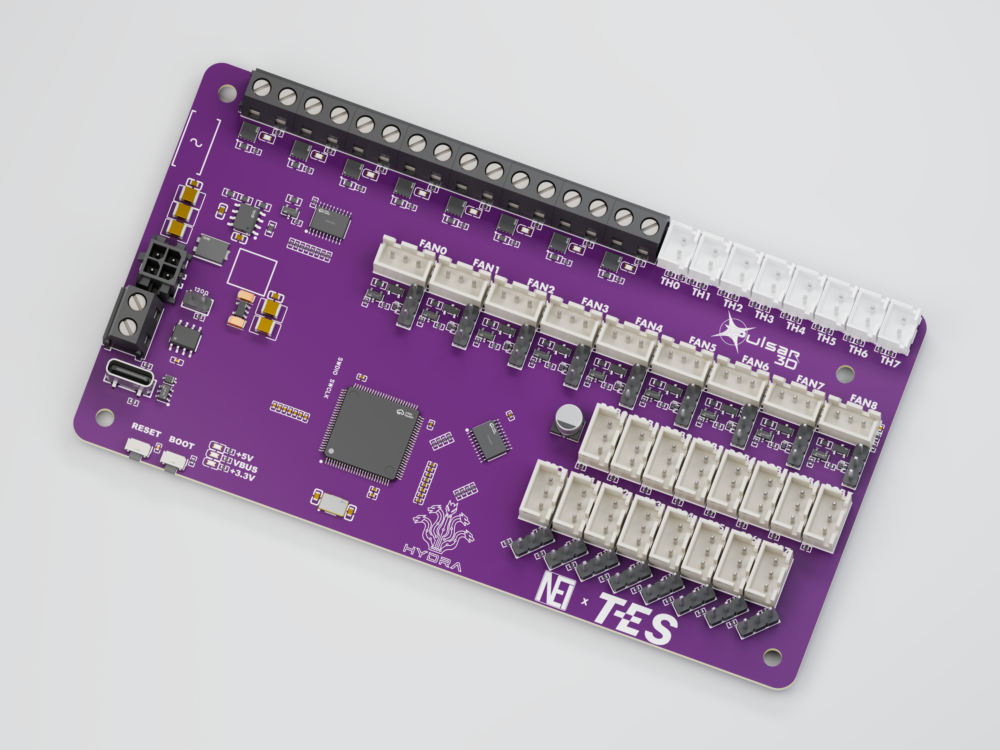

# Hydra — Hardware Reference

**Document version:** 0.1  
**Hardware revision: 1.2** 

## 1. Overview

Hydra is a purpose-built, Klipper compatible controller for multi-hotend and toolchanger 3D printers. It consolidates the heating, temperature sensing, fans, lighting, and tool sensing of up to eight hotends on a single controller. It connects to the host using USB or CAN.

Hydra is designed for use as an additional printer controller; it does not replace the printer's main motion controller.

## 2. Hardware specifications

| Feature | Specification |
| --- | --- |
| Microcontroller | STM32F446 |
| Required main power | **24 V DC nominal** |
| Heater outputs | **8 independent outputs**, up to **100 W per channel**; total simultaneous power subject to aggregate input rating |
| Temperature inputs | **8 thermistor inputs**, configurable in Klipper |
| Fan outputs | **9 independently hardware PWM controlled outputs**, each with tachometer feedback |
| Fan supply selection | **5 V or 24 V**, individually configurable by output |
| Addressable LED outputs | **8 independent 5 V** addressable RGB/Neopixel outputs |
| Endstop / auxiliary I/O | **8 ports**, each with configurable **3.3 V / 5 V sensor supply** and a directly connected GPIO signal |
| Host connectivity | **USB and CAN** |
| PCB dimensions | **70 × 140 mm** |
| Host software | **Klipper** |

The number of available outputs does not imply that every output may operate at its maximum load simultaneously. Shared supply and connector current limits apply.


### 2.1 Aggregate Input Current and Heater Power Limitations

Hydra operates from a nominal 24V DC supply. Although the board provides eight independently controlled heater outputs rated for up to 100W each, these ratings describe individual output capabilities and do not represent the maximum simultaneous heating capacity of the board.

#### Heater Supply

The eight heater outputs share a common power supply protected by a **5A fuse**.

At 24V, this corresponds to a nominal fused heater load of approximately **120W combined across all eight heater outputs**.

| Parameter | Rating |
| --- | --- |
| Individual Heater Output | 100W maximum |
| Number of Heater Outputs | 8 |
| Installed Heater Fuse | 5A |
| Nominal Combined Heater Power at 24V | 120W |

For reference:

- **One 100W heater:** approximately 4.17A
- **Two 100W heaters:** approximately 8.33A combined
- **Eight 100W heaters:** approximately 33.33A combined

The installed fuse is shared across all eight heater outputs. Therefore, operating multiple heaters simultaneously at their full rated power may exceed the heater supply's available current capacity.

**Important:** The 5A fuse is an overcurrent protection device, not an active current limiter. Its response depends on current magnitude, duration, temperature, and fuse characteristics. 

#### Simultaneous Heater Operation

Hydra supports independent heater control through Klipper. Multiple heaters can be configured and operated simultaneously, provided their combined electrical demand remains within the board's operating limits.

During initial heating, heater outputs may operate at or near 100% duty cycle. This creates substantially greater demand than maintaining temperature after the target temperature has been reached.

For installations using several hotends, users should consider staggering heater warm-up operations and limiting unnecessary simultaneous heating.

PWM duty cycle and the timing of overlapping heater loads affect current demand. Users should not assume that average heater power alone guarantees operation below the fuse's limits.

#### Total 24V Input Current

The 5A heater fuse does **not** establish a 5A limit for the entire Hydra board.

Total input current also includes:

- Heater power consumption
- Fan power consumption
- Power converted for the onboard 5V rail
- Onboard electronics and miscellaneous loads

The approximate combined input current can be expressed as:

    I_input = I_heaters + I_24V_fans + I_5V_conversion + I_other

The total input current must remain within the ratings of the board's power input, power distribution, and connected power supply.

| Parameter | Rating |
| --- | --- |
| Main Input Voltage | 24V DC |
| Installed Heater Fuse | 5A |
| Maximum Aggregate 24V Input Current | 20.5A |
| Maximum Continuous 5V Rail Load | 5A |

#### Power Supply Selection

The external 24V power supply must be appropriately sized for the expected combination of heater, fan, LED, and onboard electronic loads.

When calculating power requirements, account for the conversion losses associated with the onboard 5V supply.


### 2.2 Heater Fuse and Power Distribution Capacity

Hydra is equipped with a **5A heater supply fuse** as a deliberate safety measure. This fuse rating should not be confused with the electrical current-handling capability of the PCB itself.

Hydra's power distribution system was designed with substantial electrical and thermal headroom, including:

- **2 oz copper PCB construction** for increased current-carrying capacity.
- **Generously sized power traces** to minimize resistance and voltage drop.
- **Substantial thermal mass and copper distribution** to assist with heat dissipation.
- **Conservative power distribution design** intended to accommodate demanding multi-hotend applications.

During development, Hydra successfully operated with approximately **700W of heater load** (29.2A at 24V) under test conditions, demonstrating that the board's underlying power distribution capabilities extend well beyond the nominal 5A fuse rating.

#### Why a 5A Fuse?

The installed 5A fuse provides a conservative level of overcurrent protection for typical hotend-changer applications.

Most hotends require their greatest power during initial heating. Once at temperature, maintaining heat typically requires considerably less average power.

With appropriately coordinated or staggered heater operation, multiple hotends can maintain their target temperatures while keeping aggregate power consumption relatively low.

The fuse serves as a protective component rather than an indication of the PCB's maximum electrical capability.

#### Important Operating Considerations

- The **5A fuse remains the governing protection rating** for the heater supply in the standard production configuration.
- A 5A fuse does not actively restrict current to 5A; it interrupts excessive current according to its time-current characteristics.
- The demonstrated 700W test load is not a published continuous operating rating for production units.
- Board level current capability and installed overcurrent protection are separate specifications.
- Higher current operation requires appropriate protection, power delivery, and validation for the intended configuration.

**Do not replace or bypass the factory installed fuse solely to increase available heater power.** Doing so may compromise the intended protection of the production assembly.


## 3. Electrical operating limits

**Important:** All loads must remain below **both** their individual connector/channel limits **and** the applicable shared supply limits.

| Parameter | Limit / operating requirement | Notes |
| --- | --- | --- |
| Main input voltage | **24 V DC nominal** | Do not connect a 12 V or 48 V supply. |
| Total main input current | **20.5A**| Includes aggregate heater, fan, and onboard loads. See 2.1 |
| Heater output power | **100 W maximum per output** | At 24 V, 100 W corresponds to approximately 4.17 A on one channel. |
| Aggregate simultaneous heater power | **120W** | **Not automatically 800 W** because eight output channels exist. |
| 5 V rail, combined continuous output current | **5A** | Shared across onboard electronics, 5 V fans, RGB outputs, and connected 5 V accessories. |
| Fan output current, per channel | **1.5A** | Applies independently of the total shared-supply limits. |
| Addressable LED output, per connector | **1A** | All eight ports share the board's 5 V rail. |
| External 3.3 V sensor-supply budget | **2.6A** | Not a general-purpose high-current power output. |
| External 5 V sensor-supply budget | **Part of shared 5 V limit** | Include sensor consumption in the 5 V load calculation. |

### 3.1 Planning the 5 V power budget

The board's 5 V supply is **shared**, not a separate supply for each fan or lighting port.

Use the following planning relationship:

```
5 V load = onboard 5 V consumption
         + total current of fans selected for 5 V
         + total current of connected RGB LEDs
         + external 5 V sensor/accessory loads
```

The resulting continuous load **must not exceed the published, production-validated 5 V rail rating**. Reserve headroom for startup current and transient loads.

For reference only, conventional RGB addressable LEDs may draw up to approximately **60 mA per RGB LED** at full-intensity white; use the actual LED manufacturer's specifications when calculating load. Longer LED chains may require their own appropriately designed power supply and wiring. Do not backfeed external 5 V supplies into Hydra without an approved wiring arrangement.

### 3.2 Heater power

Each heater output is intended for a **24 V, up to 100 W** heater. An individual 100 W heater draws approximately **4.17 A at 24 V**.

**Eight times 100 W equals an 800 W theoretical sum, not a validated simultaneous operating allowance.** Observe the published aggregate heater current rating, supply input limit, power distribution limits, and any installed fuse limits once finalized. Size the external supply, wiring, connectors, and protection for the actual expected simultaneous load.

Every configured heater must have an appropriate associated temperature sensor and correctly configured Klipper heater limits and safety functions. Never energize a heater without functional temperature feedback.

### 3.3 Fans

Hydra provides nine independently controlled hardware PWM fan outputs, each with tachometer feedback. Each fan output can be configured for 5 V or 24 V supply operation.

- Match the selected output voltage to the actual fan rating **before connecting the fan**.
- Fan current must remain below its per-port rating and the applicable shared supply rating.
- Tachometer operation depends on the fan's interface and Klipper configuration.

### 3.4 Addressable RGB

Eight independent 5 V addressable RGB/Neopixel connections are available. Account for the **full connected LED current** in the shared 5 V power budget. These outputs are not 12 V or 24 V LED strip power outputs.

### 3.5 Endstop and auxiliary GPIO

Eight ports may be used for endstops, tool-dock detection, filament sensors, or other compatible digital I/O applications. Each connector offers selectable 3.3 V or 5 V accessory supply.

The signal line is directly connected to MCU I/O rather than an isolated or independently voltage-translated interface. **Selecting 5 V accessory power does not automatically establish the safe signal voltage of every attached device.** Confirm device type, drive mode, and the published GPIO signal requirements before connecting active sensors or external electronics.

## 4. Host connection and firmware

Hydra supports USB and CAN host communication with Klipper.

- Use the correct MCU firmware build and communication interface for the production hardware.
- CAN bus installations must follow normal bus wiring and termination practices; terminate only at physical bus ends.
- USB is a communication interface. **Use the specified 24 V main input for normal board operation.**
- Additional Klipper configuration and firmware flashing instructions should are supplied separately as verified, revision specific files.

## 5. Installation and handling

1. Disconnect all printer power before wiring or moving jumpers.
2. Verify main power polarity and supply voltage before first startup.
3. Select the correct fan supply voltage and sensor accessory voltage for **every** connected device.
4. Verify heater and thermistor channel pairing in Klipper before energizing heaters.
5. Verify fan rotation, PWM operation, and tachometer readings before relying on automated cooling.
6. Verify that the total simultaneous 24 V and 5 V power loads remain within the **published validated limits**.
7. Mount the PCB using suitable standoffs and maintain clearance from conductive surfaces and high-temperature components.

## 6. Mechanical information

**PCB footprint:** 75 × 140 mm.



*Board outline: 75 × 140 mm. Refer to an approved mechanical drawing for mounting-hole and connector locations.*

Mounting hole locations, hardware clearance, and connector orientation should be taken from an approved mechanical drawing for the relevant hardware revision; do not infer them from the image dimensions alone.

## 7. Support and project resources

- **Product page:** https://pulsar-3d.com/products/hydra
- **Documentation and user resources:** https://github.com/Pulsar3D-Official/Hydra

## 8. Documentation scope and intellectual property

This reference is intended to help owners **install, configure, and safely operate** Hydra.

The Hydra hardware design is proprietary. Schematics, PCB design files, fabrication data, bill of materials, and circuit implementation details are **not part of the public documentation**. No license to manufacture derivative or reproduction hardware is granted by publication of this document.

Specifications may be updated for production revisions. Check the documentation for your board revision before installation or modification.
