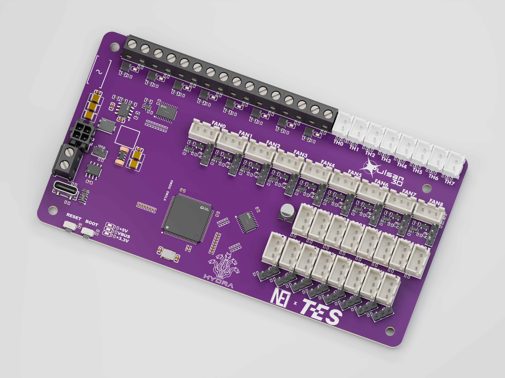
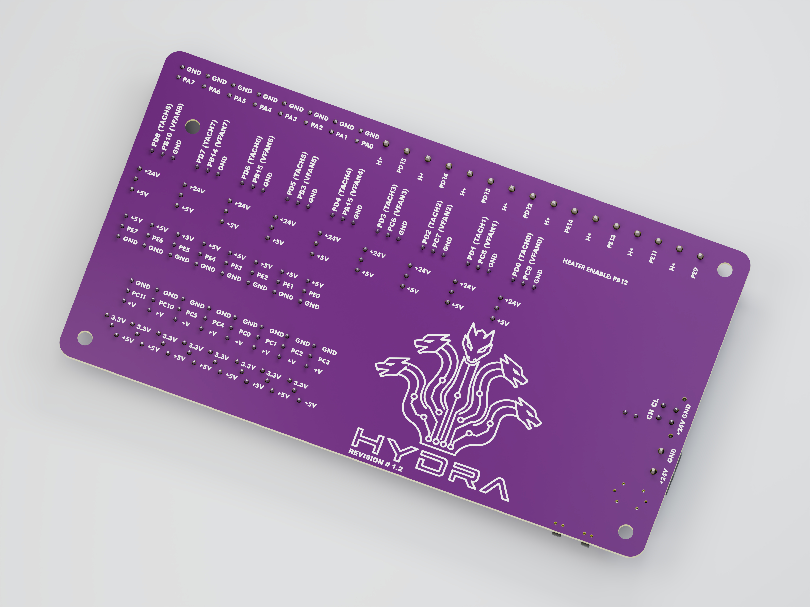

# Hydra

Hydra is a multi-hotend control board for hotend changers, made for makers putting together a printer that works with more than one hotend.

This work is licensed under a [Creative Commons Attribution-NonCommercial 4.0 International License](https://creativecommons.org/licenses/by-nc/4.0/).
